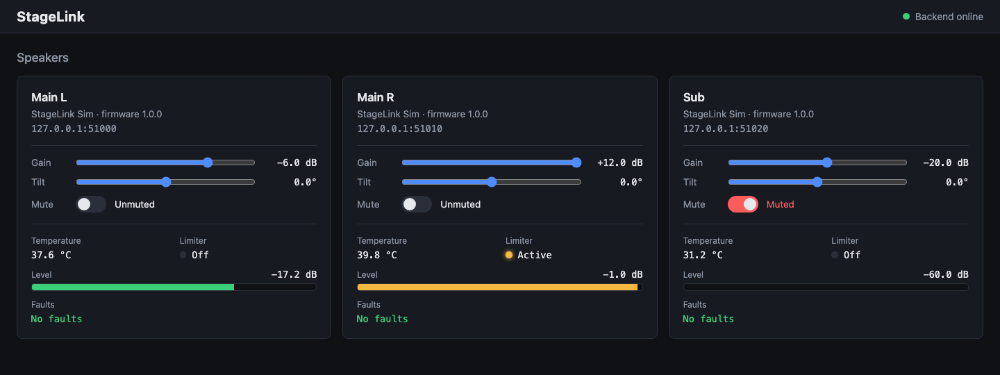
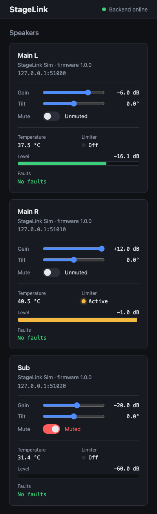
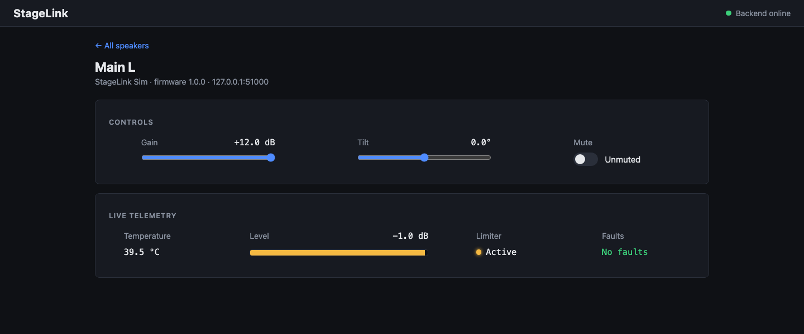
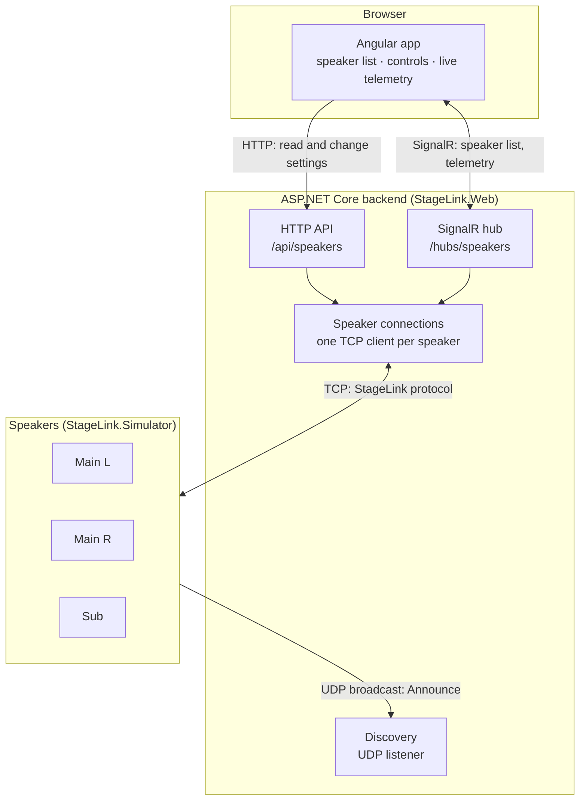

# StageLink

Remote control and live monitoring for networked loudspeakers: a custom binary protocol, a speaker simulator, an ASP.NET Core backend and an Angular web app, built test-first.



## What it does

- **Finds speakers automatically.** Each speaker announces itself on the local network over UDP, and the app lists it within seconds. Nobody types an IP address.
- **Monitors the whole system at once.** Every speaker's controls and live readings are on the main screen, so nobody has to open speakers one by one during a show.
- **Controls them.** Gain, tilt and mute, with clear error messages when a speaker refuses a value.
- **Shows live telemetry.** Temperature, output level, limiter and faults, pushed to the browser 5 times a second.
- **Stays in sync.** A change made in one browser tab shows up in every other tab watching the same speaker.
- **Works on any screen.** The layout adapts from a wide desktop to a phone.

On a phone, the cards stack into a single column:

<p align="center">
  
</p>

Each speaker also has its own page with a larger view:



## Architecture



Browsers can't open raw TCP connections or listen for UDP, so the backend is the bridge: it speaks the binary protocol to the speakers and offers the browser HTTP and SignalR instead. All protocol code lives in one shared C# library, `StageLink.Protocol`, used by both the simulator and the backend.

## Quick start

Requirements: [.NET 10 SDK](https://dotnet.microsoft.com/download) and [Node.js 22+](https://nodejs.org/).

```bash
./scripts/start.sh
```

Then open **http://localhost:4200**. The script builds everything, starts three simulated speakers ("Main L", "Main R", "Sub"), the backend and the web app, and stops all of them with **Ctrl+C**. It runs on macOS, Linux and WSL on Windows.

<details>
<summary>Running the parts separately</summary>

```bash
# A simulated speaker (TCP port, name)
dotnet run --project src/StageLink.Simulator.Host -- 51000 "Main L"

# The backend, on http://localhost:5080
dotnet run --project src/StageLink.Web

# The web app, on http://localhost:4200 (forwards /api and /hubs to the backend)
cd web && npm install && npm start
```

</details>

## The protocol

Every message is a binary frame. Multi-byte values are big-endian.

| Start marker | Version | Command | Message number | Length | Data | CRC |
|---|---|---|---|---|---|---|
| `53 4C` ("SL") | 1 byte | 1 byte | 2 bytes | 2 bytes | *length* bytes | 2 bytes |

- **Message numbers** match each reply to its request, even when replies and telemetry arrive interleaved.
- **CRC-16/CCITT-FALSE** detects corrupted frames.
- **Fixed-point values:** gain, tilt and temperature are sent as whole numbers × 100 (−6.5 dB → `FD 76`).
- **Discovery:** speakers broadcast an Announce frame over UDP every 2 seconds.

Example, *set gain to −6.5 dB, message 1*: `53 4C 01 20 00 01 00 02 FD 76 CA 6B`

The full specification (every command, reply, error code and simulator rule) is in [ROADMAP.md](ROADMAP.md#protocol-format).

## Tests

**261 automated tests**, written before the code (test-driven development):

| Project | Tests | Covers |
|---|---:|---|
| `StageLink.Protocol.Tests` | 73 | Byte reading and writing, fixed-point, CRC-16, frame encoding and validation, stream framing |
| `StageLink.Simulator.Tests` | 68 | Speaker behavior, telemetry simulation, TCP server, UDP announcements |
| `StageLink.Web.Tests` | 56 | Discovery, request/reply matching, the HTTP API end to end, SignalR |
| Angular (`web/`) | 64 | Services, the live connection, every page and component |

```bash
dotnet test                                # .NET
cd web && npx ng test --watch=false        # Angular
```

The integration tests run real TCP, UDP and SignalR traffic against a real simulator on localhost. Hand-written fakes cover misbehavior the simulator never shows, such as replies out of order, no reply at all, or a connection dropped mid-request.

## Design decisions

- **One shared protocol library.** The simulator and the backend use the same tested code, so they can't drift apart.
- **Framing over TCP.** TCP delivers a stream of bytes, not messages. `FrameReader` uses the start marker and the length field to cut it into frames, even when they arrive split or glued together.
- **Request/reply matching.** Each request waits for the reply with its own message number, with a timeout, so many commands can be in flight on one connection at once.
- **Fail clearly, never silently.** Values that don't fit the wire format are rejected before sending (an early bug let +400 dB silently wrap to a negative number). Corrupted frames are skipped, and speaker rejections become HTTP `422` with a readable message.
- **Push instead of polling.** Telemetry streams only while someone is watching: the backend subscribes when the first browser opens a speaker and unsubscribes when the last one leaves.
- **Optimistic UI.** Controls react instantly and jump back with an error if the speaker refuses, and they follow changes made elsewhere without overriding a change that's still on its way.

## Project structure

```
src/
  StageLink.Protocol/          binary protocol: frames, CRC, byte reader/writer
  StageLink.Simulator/         simulated speaker: state, commands, TCP server, UDP announcer
  StageLink.Simulator.Host/    console app that runs one simulated speaker
  StageLink.Web/               ASP.NET Core backend: discovery, speaker connections, API, SignalR
tests/                         xUnit tests for each project
web/                           Angular app (core services, speaker pages, test fakes)
scripts/start.sh               starts the whole demo
```

## Tech stack

**C# / .NET 10** · ASP.NET Core (minimal APIs, SignalR, background services) · xUnit · **Angular 21** (standalone components, signals) · TypeScript · Vitest
